# Predicting One’s Kill-Death Ratio Category Based on Performance Metrics

**Author:** Robert Thomas Kohn  
**Course:** MTH 319 - Predictive Statistics  
**Institution:** Muhlenberg College  
**Date:** March 7, 2024  

---

## Abstract
In esports analytics, analysts and players frequently investigate how specific in-game contributions impact an individual's overall kill-to-death ($K/D$) ratio. This project investigates this question within the context of *Counter-Strike 2* (Valve Corporation), analyzing competitive match data from the PGL Major Copenhagen 2024 collected by Vansh Bordia and published on Kaggle.

The predictors evaluated against player performance include total multi-kill rounds, 1-vs-X ($1\text{v}X$) clutch win percentage, MVP awards, headshot count, opening kills, and opening deaths. Because player skill distributions exhibit severe variance and non-linear boundaries, continuous linear regression is prone to substantial error across extremes. Consequently, player $K/D$ was discretized into five ordered competitive performance tiers: $0.00\text{--}0.75$, $0.75\text{--}0.90$, $0.90\text{--}1.05$, $1.05\text{--}1.20$, and $1.20\text{--}1.60$.

Using 5-fold cross-validation with an 80/20 train/test partition, feature subsets and individual predictors were systematically evaluated across $k$ tuning values. A single-predictor model based on opening kills achieved an overall test accuracy of 36.3% (95% CI: $[17.2\%, 59.3\%]$). While extreme tiers proved difficult to classify due to sample imbalance, the model demonstrated solid utility for classifying median-tier players, offering clear insight into the role of opening entry engagements.

---

## 1. Describing the Data

The dataset analyzed is the *PGL CS2 Major Copenhagen 2024 Data* sourced from Kaggle. In competitive *Counter-Strike 2*, predicting a player's expected performance tier from granular tactical statistics offers actionable scouting and role-evaluation insights. 

Data preprocessing addressed data formatting anomalies (including missing decimal placements in raw ratios). Two composite metrics were engineered:
1. **Multi-Kill Rounds (`mk`):** Sum of rounds where a player secured at least two eliminations ($2\text{k} + 3\text{k} + 4\text{k} + 5\text{k}$).
2. **Clutch Percentage (`OvP` / `1vP`):** Ratio of 1-vs-X clutch rounds won relative to total clutch situations contested.

```
Response Variable Discretization:
  • Low End KD:     0.00 – 0.75   (Underperforming / heavy deficit)
  • Low Mid KD:     0.75 – 0.90   (Below average / support tier)
  • Mid KD:         0.90 – 1.05   (Par / 1-to-1 baseline performance)
  • High Mid KD:    1.05 – 1.20   (Impact player / positive net fragging)
  • High End KD:    1.20 – 1.60   (Star player / tournament carry)
```

The distribution of player $K/D$ ratios across the tournament is depicted below:

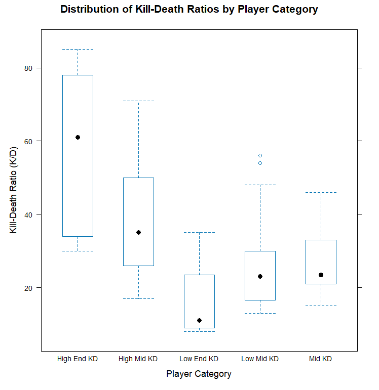

### Bivariate Analysis Across Tiers
To explore relationships between tactical metrics and $K/D$ tiers, distributions were examined across each predictor:

| Predictor | Boxplot Distribution | Key Finding |
| :--- | :--- | :--- |
| **Multi-Kills (`mk`)** | 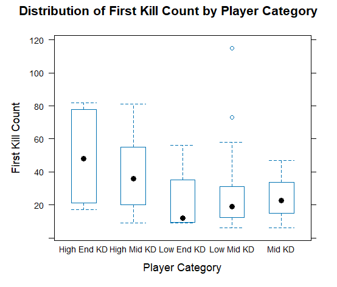 | High End KD shows the highest median and widest range; 2 outliers in Low Mid tier. |
| **MVPs (`mvp`)** | 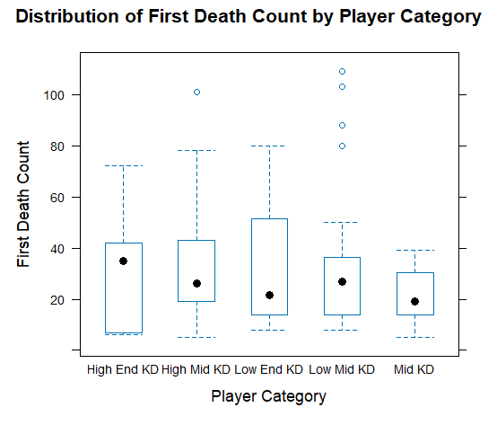 | Strong positive progression with performance tiers; 5 outliers in Low Mid tier. |
| **Headshots (`headshot_count`)** | 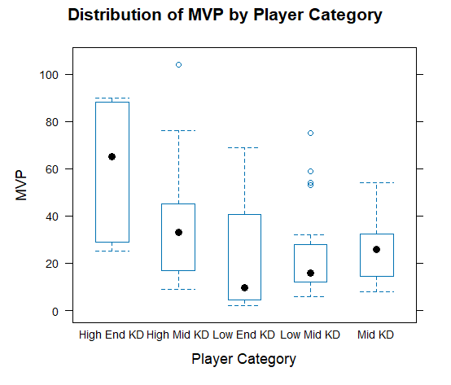 | Higher overall volume in upper tiers; noticeable spread in High Mid tier. |
| **Clutch Win % (`OvP`)** | 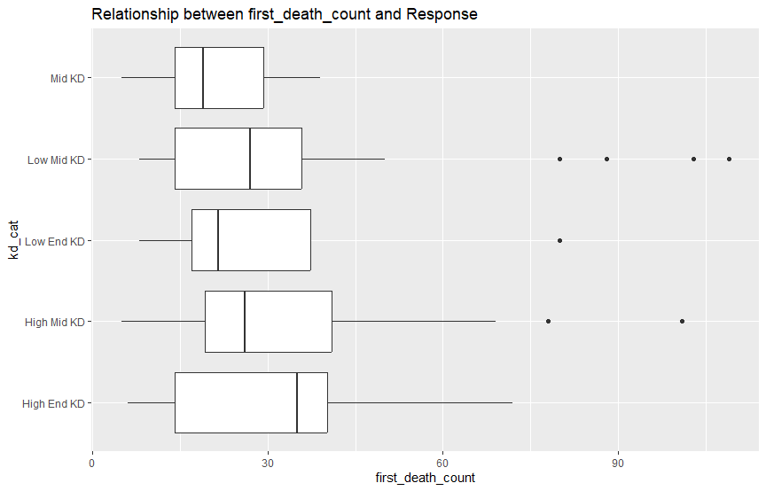 | Surprisingly flat across tiers; clutches occur across all roles regardless of rating. |
| **Opening Kills (`first_kill_count`)**| 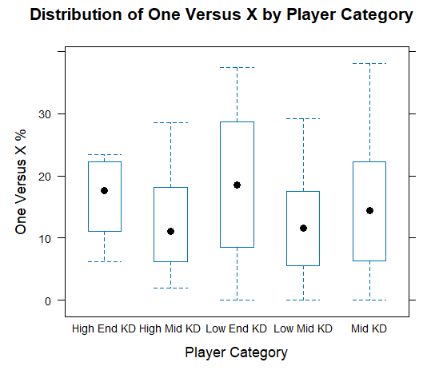 | Marked positive separation; high entry success strongly aligns with top tiers. |
| **Opening Deaths (`first_death_count`)**| 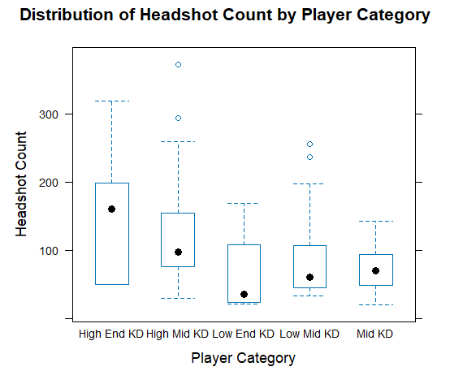 | High variance across entry players; both star entries and struggling players accumulate opening deaths. |

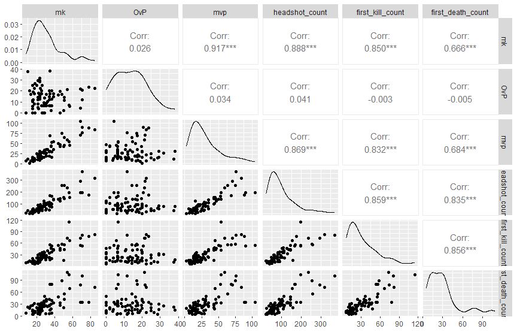

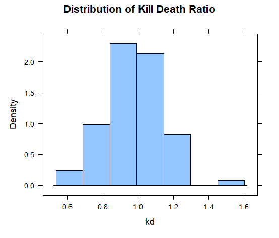

The strongest observed linear correlation was between **MVP rounds and Multi-Kill rounds ($r = 0.917$)**, reflecting that securing multiple frags in a round is the primary trigger for being awarded the round MVP. Conversely, the correlation between first kill count and clutch percentage was negligible, indicating that aggressive opening entry-fragging and patient late-round clutching represent distinct, non-overlapping skill sets. Missing values were removed via complete-case analysis, and numerical predictors were standardized to prevent scale dominance in distance calculations.

---

## 2. Performing 5-Fold Cross-Validation

Because K-Nearest Neighbors relies on Euclidean distances, 5-fold cross-validation was implemented on an 80% training / 20% test partition to identify the optimal hyperparameter $k \in [1, 30]$ and prevent overfitting.

### Centered and Scaled vs. Uncentered KNN
Comparing feature standardization strategies demonstrates the necessity of scaling in multi-variable distance algorithms:

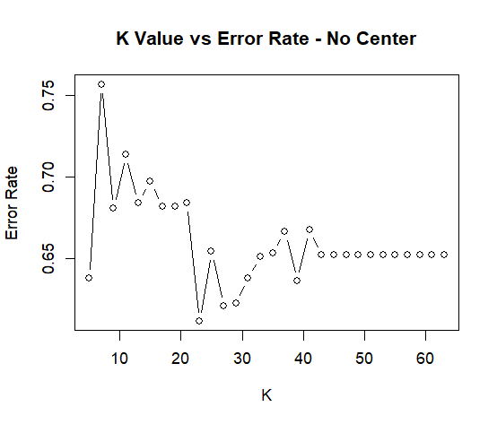

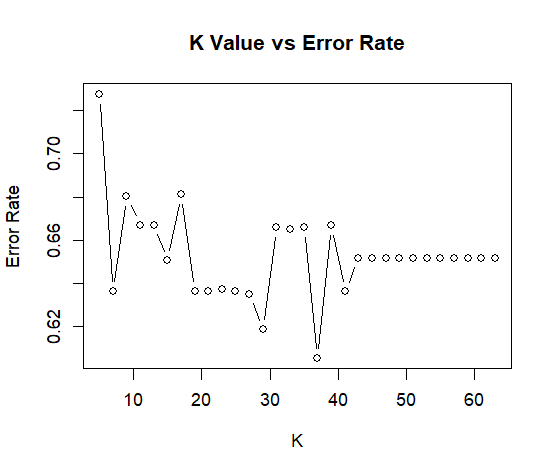

- With **centering and scaling**, cross-validation identified an optimal $k = 27$ (and competitive $k = 37$), yielding an optimal training accuracy of ~39.5% (error rate: 0.606).
- Without centering or scaling, error rates were uniformly elevated across nearly all candidate values of $k$, demonstrating how unscaled variables like raw headshot counts distort nearest-neighbor calculations.

### Feature Pairing Comparison
To evaluate which tactical metrics provide the cleanest decision boundaries, pairs of predictors were tested under identical 5-fold cross-validation:

1. **Headshots + 1vX Clutch Win %:** Optimal $k = 27$, Accuracy = 36.5%, Error Rate = 0.635.
2. **Multi-Kill Rounds + MVPs:** Optimal $k = 37$, Accuracy = 41.2%, Error Rate = 0.587.
3. **Opening Kills + Opening Deaths:** Optimal $k = 5$, Accuracy = 46.7%, Error Rate = 0.533.

The combination of **Opening Kills and Opening Deaths** yielded the lowest error rate among all pairings. Opening engagements directly dictate a player's round trajectory: netting an opening kill guarantees a minimum $1.0$ $K/D$ for that round while providing round-winning momentum. Conversely, dying first immediately bounds that round's contribution to zero kills and one death.

When isolated individually, **Opening Kills alone** achieved 42.4% CV accuracy (error rate: 57.6%), outperforming Opening Deaths alone (39.0% accuracy, error rate: 61.0%).

---

## 3. Refitting the Model and Out-of-Sample Evaluation

The final model was refit using the dominant predictor variable (Opening Kills) and evaluated against the held-out 20% test partition:

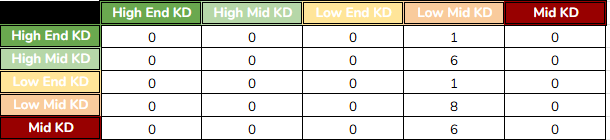

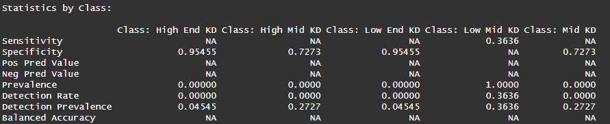

### Performance Diagnostics
- **Overall Test Accuracy:** 36.3% (95% CI: $[17.2\%, 59.3\%]$)
- **Class-Specific Detection:**
  - High End KD Specificity: $0.955$
  - High Mid KD Specificity: $0.727$
  - Mid KD Specificity: $0.727$
  - Low End KD Specificity: $0.955$

The model exhibits a bell-shaped detection pattern: predictions concentrate heavily in the modal Low-Mid and Mid tiers ($0.75\text{--}1.05$), where tournament players naturally cluster, while extreme tiers ($<0.75$ and $>1.20$) suffer from low sensitivity due to small class counts.

### Scenario Predictions for New Player Profiles
To test model behavior across the observed range of opening kills ($\min = 6, \text{mean} = 30.75, \max = 115$), predictions were generated for three synthetic player profiles:

1. **Zero Opening Kills (0):** Predicts **Low Mid KD** ($0.75\text{--}0.90$). Captures pure passive/support anchors.
2. **Average Opening Kills (30):** Predicts **Mid KD** ($0.90\text{--}1.05$). Accurately reflects baseline median performance.
3. **Superstar Volume (120 Opening Kills):** Predicts **High Mid KD** ($1.05\text{--}1.20$). Reflects heavy offensive contribution, though conservative nearest-neighbor averaging stops short of predicting the extreme High End tier.

---

## 4. Reflection & Discussion

This investigation revealed clear structural insights into Counter-Strike analytics:
- **Dominance of Opening Duels:** Opening entry engagements serve as the single most reliable predictor of overall rating. Players who win opening duels consistently secure positive performance ratings.
- **Independence of Clutches:** 1-vs-X clutch percentage showed surprisingly minimal correlation with $K/D$ category. Highly paid clutch players frequently post modest overall ratings while winning pivotal individual rounds, indicating that clutch ability is a specialized tactical trait rather than a volume driver.
- **Model Limitations:** While KNN provides intuitive geometric decision boundaries, its global accuracy (~36%) is constrained by class imbalance at the extremes and the absence of utility damage/assist data. For practical team scouting, combining opening duel metrics with economic and grenade effectiveness metrics in ensemble tree models would likely improve classification stability.
