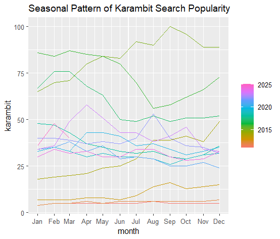
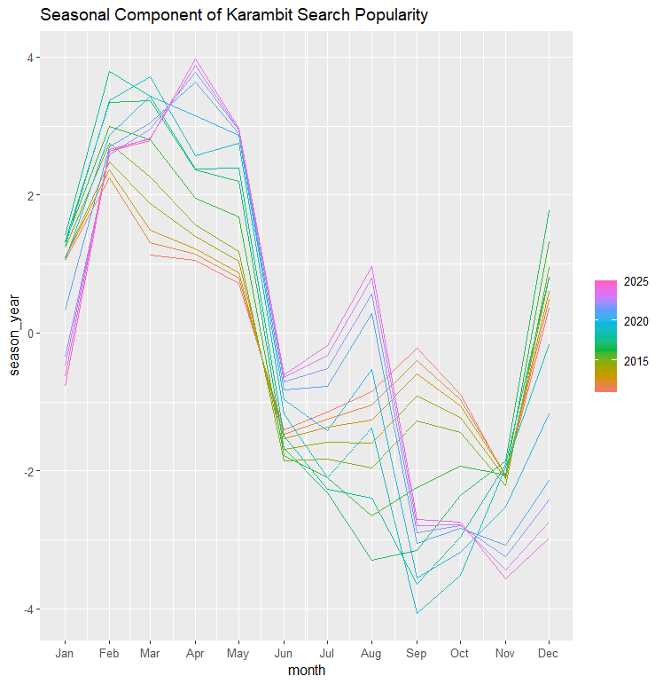
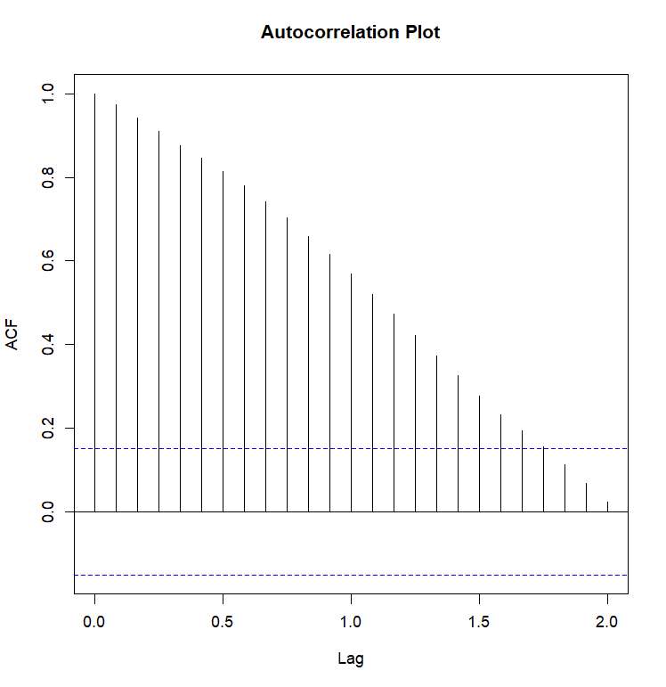
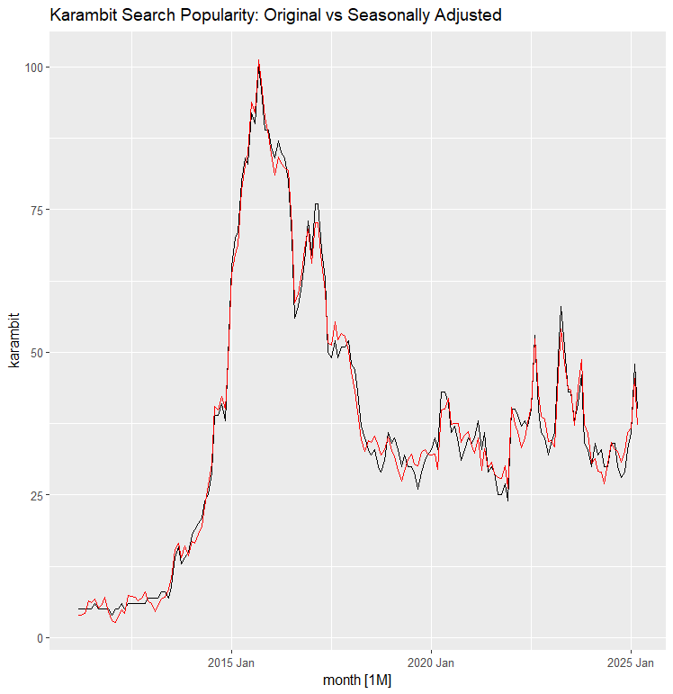
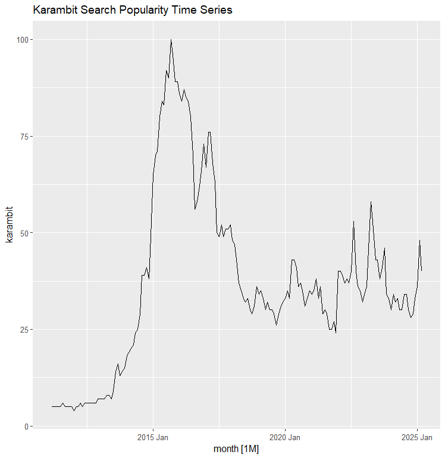
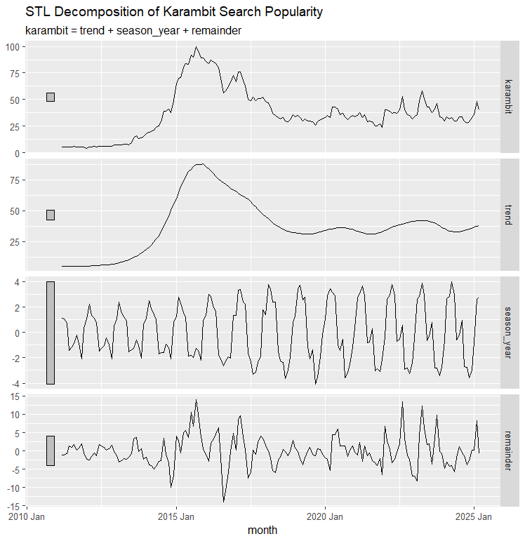
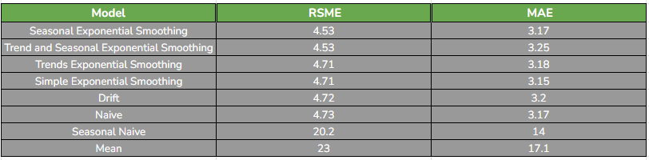
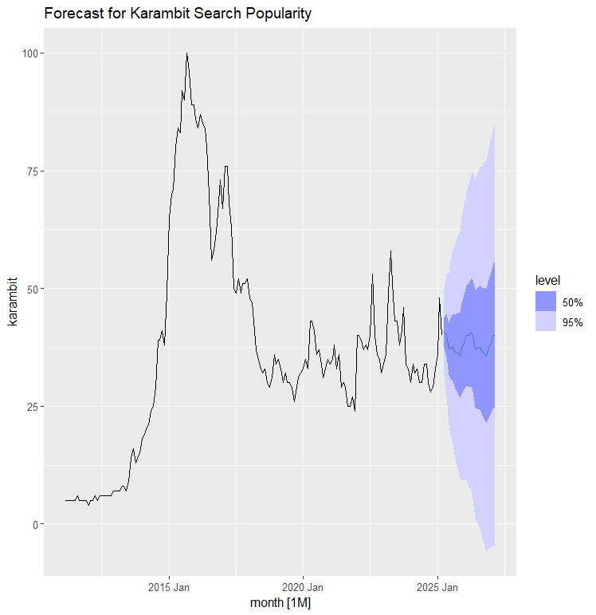
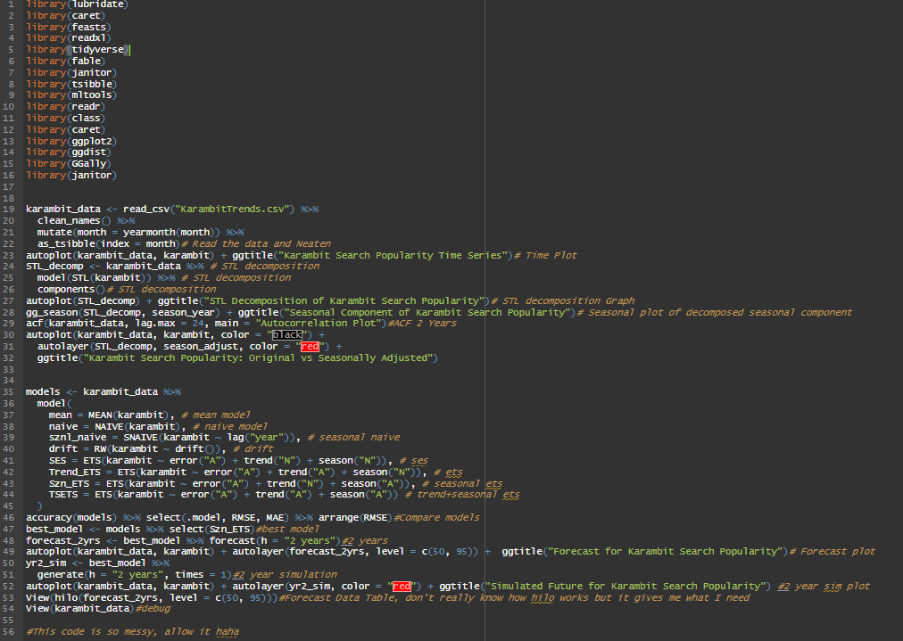
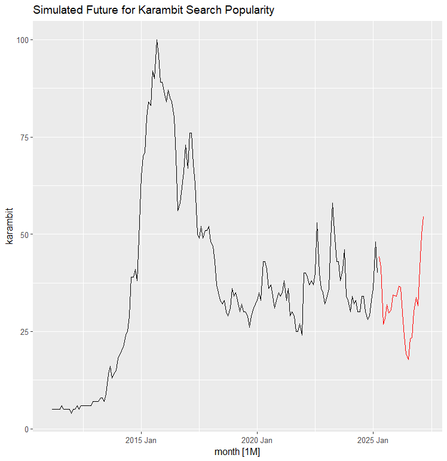

# Analyzing and Forecasting "Karambit" Search Trends Using Time Series Methods

**Author:** Robert Thomas Kohn  
**Course:** MTH 319 - Predictive Statistics  
**Institution:** Muhlenberg College  
**Date:** April 11, 2024  

---

## Abstract
Counter-Strike is a gaming franchise spanning over two decades that revolutionized the video game economy through the introduction of the Steam Community Market in *Counter-Strike: Global Offensive* (CS:GO). Among all virtual cosmetics, the **Karambit**—a curved knife skin modeled after traditional Indonesian blades—stands as one of the most iconic and liquid digital luxury assets, with top-tier rare variants selling for upwards of $1,500,000.

This study analyzes worldwide Google Trends search volume for the query "Karambit" from March 2011 through March 2025 (169 monthly observations), capturing the pre-release baseline, the initial 2014–2016 CS:GO market boom, the subsequent maturation cycle, and the 2022–2024 resurgence surrounding *Counter-Strike 2*.

Using the `fable` and `feasts` tidy time series framework, the series was decomposed via STL into trend-cycle, seasonal, and remainder components. Multiple benchmark models (Mean, Naive, Seasonal Naive, Drift) and Exponential Smoothing state-space models (SES, Holt's Linear Trend, Seasonal ETS, Holt-Winters Additive) were evaluated. The Seasonal ETS model ($\text{ETS}(A,N,A)$) minimized Root Mean Squared Error ($\text{RMSE} = 4.53$, $\text{MAE} = 3.17$), producing a 2-year probabilistic forecast with 50% and 95% prediction intervals and a simulated future realization.

---

## 1. Describing the Data & Exploratory Time Series Analysis

The search query "Karambit" was extracted worldwide from Google Trends across the 14-year period from March 26, 2011 to March 26, 2025. Because CS:GO launched in August 2012 and the *Arms Deal* update introducing knife skins arrived in August 2013, the first two years provide a baseline measure of knife-related interest before virtual skin market dynamics took hold.



### Key Observations from the Time Plot
1. **Steady Expansion (2014–2016):** Following the release of weapon skin cases and third-party trading websites, search interest expanded steadily, peaking in mid-2016.
2. **Prolonged Correction (2017–2021):** Post-peak stabilization and plateau as the skin market matured.
3. **CS2 Announcement Spike (2022–2023):** Search interest experienced a sharp resurgence following Valve's official announcement and subsequent release of *Counter-Strike 2*.



Seasonal plots demonstrate recurring spring peaks (February through April) and autumn troughs (September and October). However, seasonal fluctuations remain small in magnitude relative to the macroeconomic gaming lifecycle.

---

## 2. STL Decomposition & Autocorrelation

To isolate underlying structural patterns, the series was decomposed using **STL (Seasonal and Trend decomposition using Loess)**:

$$y_t = T_t + S_t + R_t$$





### Decomposition Insights
- **Trend Dominance:** The vertical scale of the trend component is substantially larger than both the seasonal and irregular remainder bars, confirming that multi-year gaming cycles drive the series.
- **Irregular Remainder Shocks:** The remainder exhibits higher variance than the seasonal component, reflecting discrete market shocks corresponding to Valve game updates, operation passes, and tournament majors.
- **Seasonally Adjusted Series:** Plotting the raw series against the seasonally adjusted series ($y_t - S_t$) shows nearly identical trajectories, illustrating that seasonality plays a secondary role compared to the macro trend.



### Autocorrelation Structure (ACF)
The sample autocorrelation function was computed across 24 lags (2 years):



- Autocorrelation remains statistically significant and positive through approximately **21 months (~1.75 years)** before entering the 95% Bartlett confidence bounds.
- The slow, smooth geometric decay in the ACF reflects strong trend persistence without rapid mean-reversion.

---

## 3. Forecasting Methods & Model Comparison

Eight distinct time series models were fit and evaluated across standard in-sample accuracy metrics:

```
Benchmark Models:
  1. Mean Model:          Forecasts historical mean
  2. Naive Model:         Forecasts last observed value
  3. Seasonal Naive:      Forecasts value from same month last year
  4. Drift Model:         Random walk with linear drift trend

Exponential Smoothing (ETS) Models:
  5. SES:                 ETS(A, N, N) - Simple Exponential Smoothing
  6. Trend ETS:           ETS(A, A, N) - Holt's Linear Trend
  7. Seasonal ETS:        ETS(A, N, A) - Additive Error, No Trend, Additive Season
  8. Holt-Winters ETS:    ETS(A, A, A) - Additive Error, Additive Trend, Additive Season
```



### Ranked Performance Summary
| Model | Type | RMSE | MAE | MAPE (%) | MASE |
| :--- | :--- | :---: | :---: | :---: | :---: |
| **Seasonal ETS** | $\text{ETS}(A,N,A)$ | **4.53** | **3.17** | **10.1%** | **0.226** |
| **Holt-Winters ETS** | $\text{ETS}(A,A,A)$ | 4.53 | 3.25 | 11.0% | 0.232 |
| **Trend ETS** | $\text{ETS}(A,A,N)$ | 4.71 | 3.18 | 8.95% | 0.228 |
| **SES** | $\text{ETS}(A,N,N)$ | 4.71 | 3.15 | 8.60% | 0.226 |
| **Drift** | Random Walk | 4.72 | 3.20 | 8.99% | 0.229 |
| **Naive** | Random Walk | 4.73 | 3.17 | 8.65% | 0.227 |
| **Seasonal Naive** | Lagged Benchmark | 20.2 | 14.0 | 33.1% | 1.000 |
| **Mean** | Global Mean | 23.0 | 17.1 | 120.0% | 1.220 |

While a smooth trend-based model was initially hypothesized to perform best, the **Seasonal Exponential Smoothing model ($\text{ETS}(A,N,A)$)** achieved the lowest overall RMSE (4.53). The seasonal naive and mean benchmarks performed very poorly ($\text{RMSE} > 20$), proving that dynamic adaptive smoothing is required.

---

## 4. Probabilistic 2-Year Forecast & Future Simulation

Using the optimal Seasonal ETS model, probabilistic forecasts were projected forward 24 months (April 2025 through March 2027) with 50% and 95% prediction intervals:





### Key Forecast Takeaways
- **April 2025:** Point forecast mean = $41.0$ ($95\%\text{ CI}: [31.38, 49.92]$)
- **October 2025 (Annual Trough):** Point forecast mean = $36.3$ ($95\%\text{ CI}: [11.82, 60.87]$)
- **April 2026:** Point forecast mean = $41.0$ ($95\%\text{ CI}: [7.23, 74.07]$)

Uncertainty fans out appropriately over time as the forecast horizon expands. The seasonal component preserves the recurring April peaks and October dips.

### Simulated Future Path Realization
A single simulated trajectory was generated by bootstrapping the model error distribution over the 2-year horizon:



The simulated realization depicts a moderate continuation of the current post-CS2 plateau, followed by potential volatility rebounds around spring 2027—consistent with past Valve major game update cycles.

---

## 5. Reflection & Discussion

- **Model Fit vs. Expectation:** Although the macro trend dominates the variance decomposition, incorporating additive seasonal smoothing marginally improved predictive accuracy over pure trend models by accounting for spring tournament traffic.
- **Economic Integration:** Google Trends search volume provides an effective proxy for consumer attention. For future work, pairing this search time series with secondary market skin transaction data (such as Buff163 or CSFloat sale volume) would enable cross-correlation and vector autoregression (VAR) modeling between player interest and digital asset pricing.
