# Using Classification Trees to Predict a Round’s Outcome in Counter-Strike

**Author:** Robert Thomas Kohn  
**Course:** MTH 319 - Predictive Statistics  
**Institution:** Muhlenberg College  
**Date:** May 5, 2025  

---

## Abstract
In competitive *Counter-Strike: Global Offensive* and *Counter-Strike 2*, understanding round victory conditions and economic advantages is paramount for in-game leaders and analysts. This project investigates whether machine learning tree-based methods—specifically **Single Classification Trees (`rpart`)**, **Bagged Classification Trees**, and **Random Forests**—can reliably predict the outcome of a competitive round based on pre-round economic spend, buy tiers, current scores, and map choice.

Using a dataset of professional esports round records published on Kaggle by LIvanoff, round outcomes were classified across five distinct victory states: `BombDefused`, `TargetBombed`, `CTWin` (elimination), `TerroristsWin` (elimination), and `TargetSaved` (time expiration). 

A baseline single classification tree produced an easily interpretable decision rule governed strictly by Counter-Terrorist buy tier, though with a high misclassification rate of 66.7%. Bagging improved overall performance to a 60.0% out-of-bag (OOB) error rate, while Random Forests achieved the lowest error rate at 56.3%. Across all models, **team round spend amounts** proved to be the most critical predictive features, while map identity contributed negligible signal. This report candidly discusses the statistical challenges posed by severe class imbalance and evaluates potential model refinements.

---

## 1. Describing the Data & Exploratory Analysis

The dataset, sourced from Kaggle (*CS:GO Esports Matches Round Data* by LIvanoff), records granular round-level telemetry from professional esports fixtures. Anomalous `GameStart` reset rounds were removed prior to analysis.

The target variable, `roundEndReason`, exhibits substantial class imbalance:

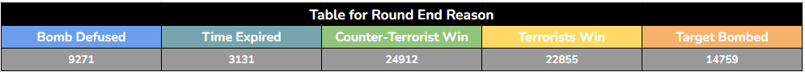

### Economic Spend Distributions Across Outcome States
The five-number summary and interquartile ranges (IQR) for team spending reveal clear economic patterns:

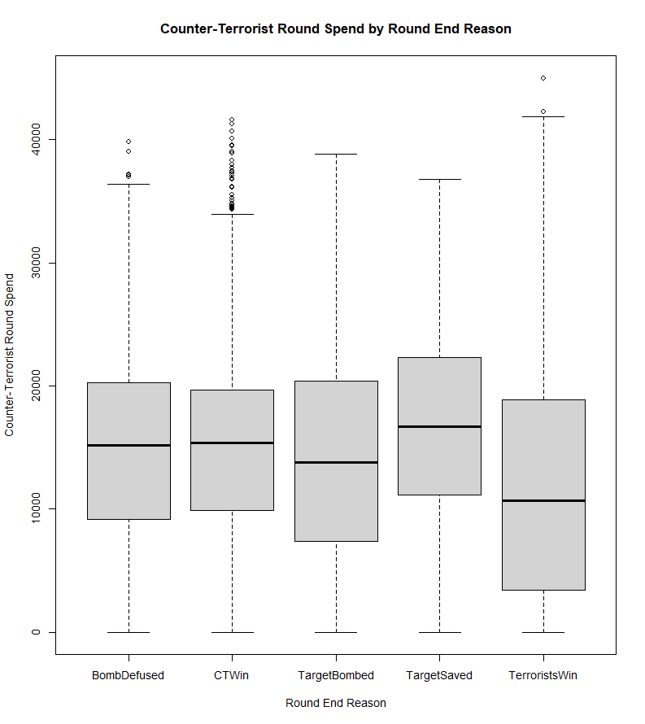

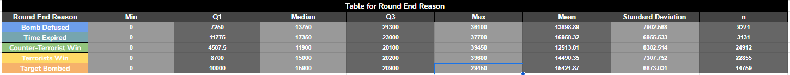

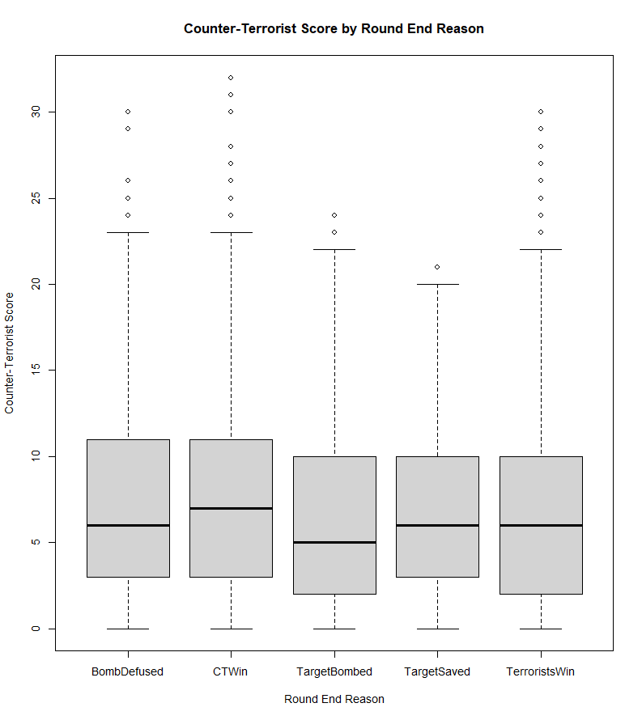

- **Counter-Terrorist Spend ($USD):** Interquartile ranges span \$9,000–\$20,000 for Bomb Defusal, \$11,000–\$18,000 for CT Win, \$7,000–\$20,000 for Target Bombed, \$12,000–\$22,000 for Time Expired, and \$3,000–\$17,000 for Terrorist Wins. Maximum buys reach \$44,000 on full rifle and AWP setups.
- **Terrorist Spend ($USD):** Follows a complementary distribution; Terrorist Wins exhibit a median spend of ~\$15,200, whereas rounds where Terrorists were eliminated often feature eco-level spending (\$0–\$6,000).

### Match Scores and Bivariate Predictor Relationships
Examining team scores reveals that scores above 20 occur predominantly in multi-overtime matches outside the typical competitive regulation range (first to 16 regulation rounds).

| Terrorist Score by Outcome | Counter-Terrorist Score by Outcome | Score Scatterplot Matrix |
| :---: | :---: | :---: |
| 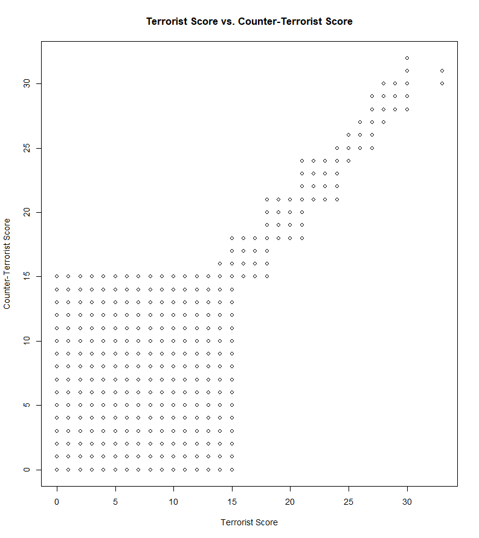 | 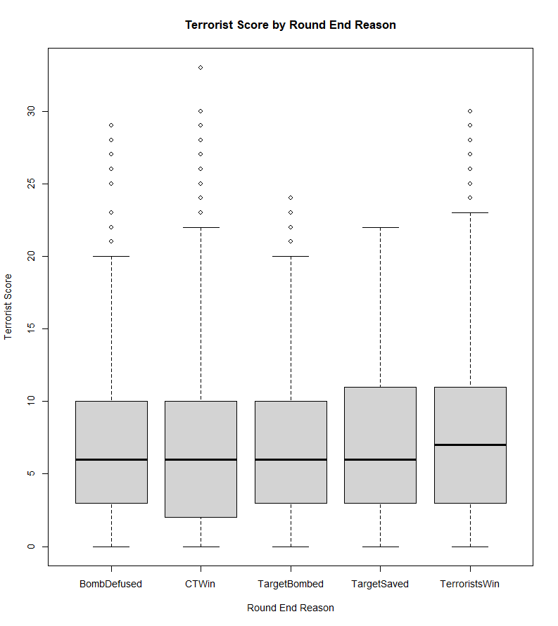 | 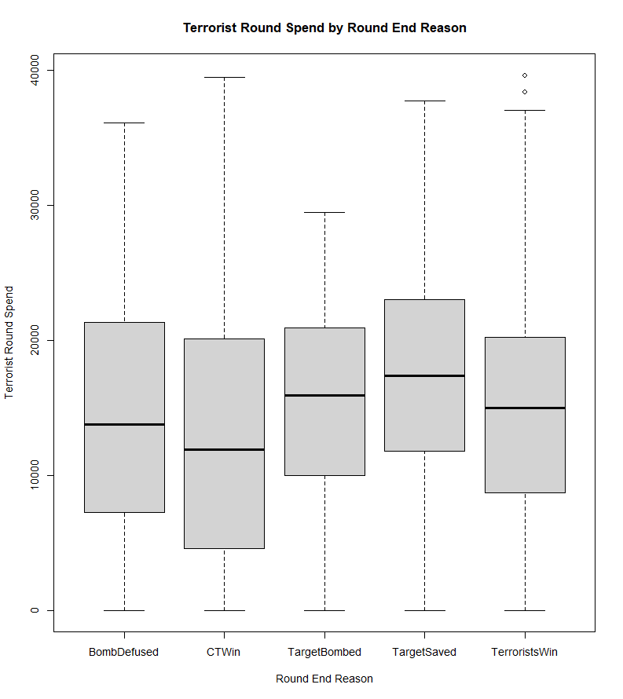 |

The correlation between CT score and CT round spending is modest ($r = 0.1607$), demonstrating that while teams with higher scores generally manage superior economy, round-to-round spend is heavily reset by deaths and loss bonus mechanics.

---

## 2. Single Classification Tree (`rpart`)

A single classification tree was fit to predict `roundEndReason` from seven predictors: Terrorist score, CT score, map name, CT round spend, CT buy type, T round spend, and T buy type.

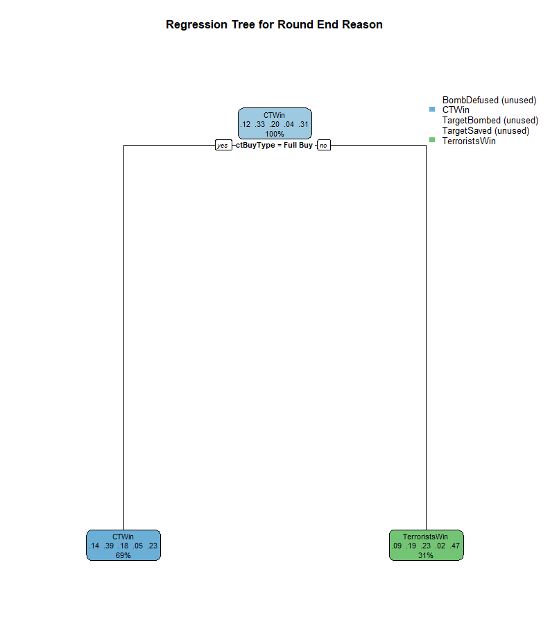

### Variable Importance Ranking
1. **CT Buy Type (`ctBuyType`):** $1644.39$
2. **CT Round Spend (`ctRoundSpendMoney`):** $797.07$
3. **CT Score (`ctScore`):** $270.71$
4. **T Round Spend (`tRoundSpendMoney`):** $143.39$
5. **T Buy Type (`tBuyType`):** $130.41$

The pruned tree isolates Counter-Terrorist buy tier as the primary splitting criterion:
- **Rule:** If CT team executes a *Full Buy*, predict **Counter-Terrorist Win**; otherwise, predict **Terrorists Win**.
- **Root Node Error:** 67.3% ($33/49$ misclassifications on sample evaluation; ~66.7% across the broader dataset).

While highly simplified, this rule mirrors a fundamental tenet of Counter-Strike: defensive Counter-Terrorists requiring expensive rifles ($M4A1\text{-}S / AWP$) and full armor are severely disadvantaged on eco rounds, virtually conceding rounds when under-equipped.

### Predictions on Competitive Match Scenarios
The tree was evaluated on three realistic competitive round archetypes:

1. **Anubis (CT Full Eco [\$3,000] vs. T Full Buy [\$20,000]):**  
   Predicts **Terrorists Win**. *Logical:* Heavily outgunned CTs with pistols fail to halt rifle executes.
2. **Mirage (CT Full Buy [\$30,000] vs. T Semi-Eco [\$6,000]):**  
   Predicts **Counter-Terrorists Win**. *Logical:* Full utility and AWP setups comfortably repel under-equipped attackers.
3. **Inferno Overtime (Equal Force Buys [\$11,250 vs. \$10,000]):**  
   Evaluates to root node default (**Terrorists Win**), reflecting parity where defensive positioning must overcome offensive momentum.

---

## 3. Bagged Classification Trees (`randomForest`, $mtry = 7$)

To mitigate the variance and instability of single trees, **Bootstrap Aggregation (Bagging)** was applied across 100 trees, evaluating all seven candidate predictors at each split:

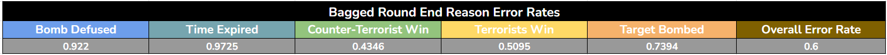

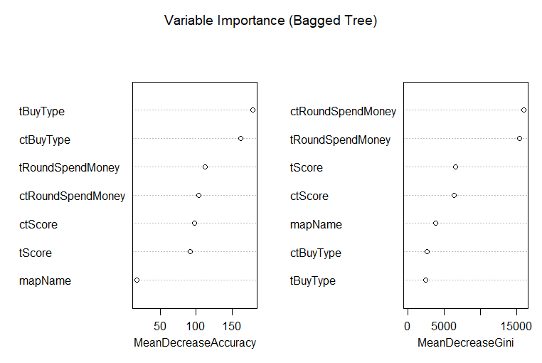

### Bagged Model Performance
- **Out-of-Bag (OOB) Overall Error Rate:** **60.0%**
- **Class-Specific Error Rates:**
  - `Bomb Defused`: $92.2\%$ misclassification
  - `Target Bombed`: $73.9\%$ misclassification
  - `Target Saved` (Time Expired): $97.3\%$ misclassification
  - `CT Win` (Elimination): $51.0\%$ misclassification
  - `Terrorists Win` (Elimination): $43.5\%$ misclassification

The dominant features identified by Mean Decrease Gini are **CT Round Spend** and **T Round Spend**, followed by team buy tiers. Map name registered the lowest importance, indicating that balanced competitive maps do not systematically bias round outcomes independently of economy.

---

## 4. Random Forests ($mtry = \lfloor\sqrt{7}\rfloor = 2$)

Random forests introduce decorrelation by randomly subsetting two features at each tree split:

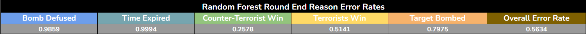

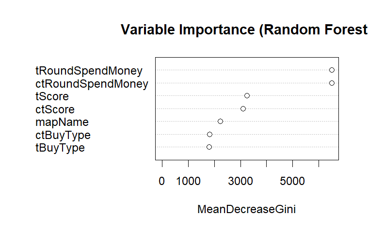

### Random Forest Performance
- **Out-of-Bag (OOB) Overall Error Rate:** **56.3%** (the lowest error rate among all tested models).
- **Class-Specific Strengths:** Eliminating Counter-Terrorists achieved an improved misclassification rate of **25.8%**, although rare tactical events (e.g., time expiring) remained nearly impossible to predict ($99.9\%$ error).
- **Scenario Consensus:** Across all three competitive scenarios (Anubis, Mirage, Inferno), the Random Forest produced consistent predictions aligned with economic dominance.

---

## 5. Reflection & Discussion

1. **Model Hierarchy and Accuracy Trade-Offs:**
   - Single Classification Tree: 66.7% error rate
   - Bagged Trees: 60.0% error rate
   - Random Forest: 56.3% error rate (43.7% accuracy)
   While the Random Forest is mathematically superior, the single classification tree provides unparalleled executive readability, distilling round outcome dynamics into immediate economic buy rules.

2. **Impact of Class Imbalance:**
   Multi-class round outcomes in Counter-Strike suffer from inherent class sparsity. Rounds ending via time expiration or bomb defusal represent rare events compared to total team wipes. Consequently, ensemble algorithms default to majority-class elimination predictions.

3. **High-Impact Future Improvements:**
   - **Binary Framing:** Collapsing outcomes into binary sides (`CT Victory` vs. `T Victory`, regardless of defusal or elimination) would eliminate class imbalance artifacts and significantly lower error rates.
   - **Momentum Features:** Integrating round win streaks, loss bonus tier counters, and utility (flashbang/smoke) inventories would provide the missing tactical context necessary to predict close rounds.
