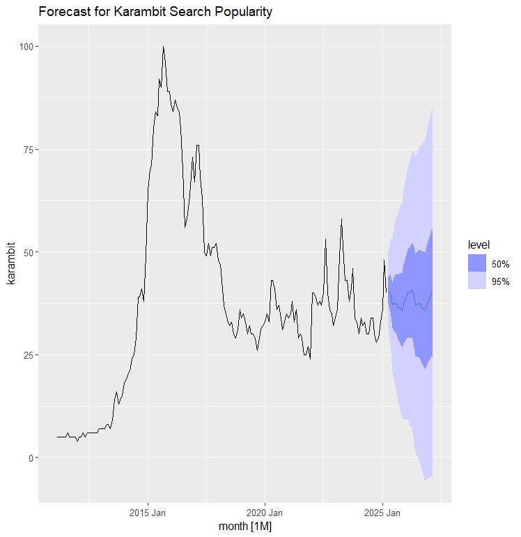
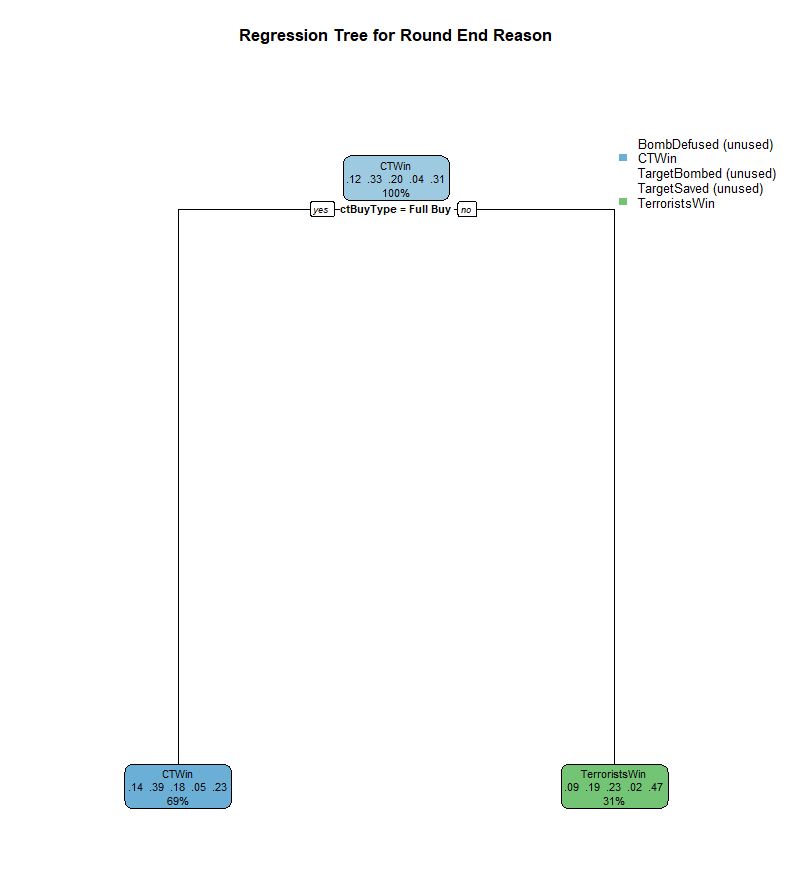
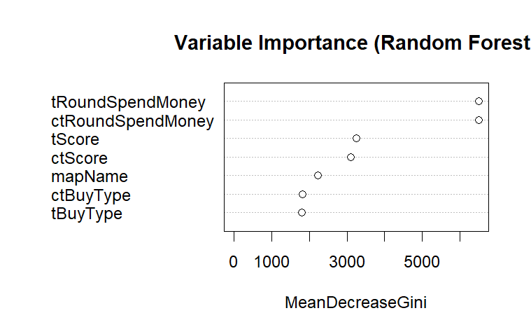
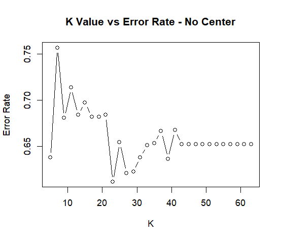
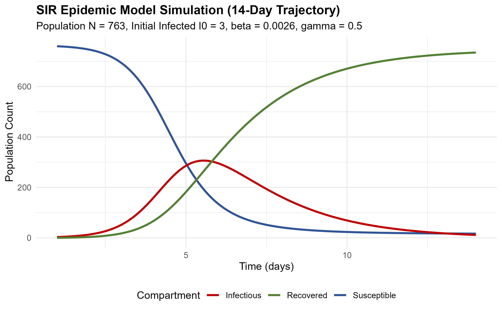
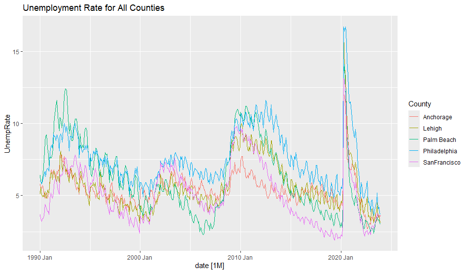

# MTH 319: Predictive Statistics & Statistical Computing

This repository contains selected statistical computing, machine learning, and quantitative modeling coursework completed by **Robert Kohn** for **MTH 319 (Predictive Statistics)** at **Muhlenberg College** (Spring 2025). It has been curated to highlight original analyses, programming pipelines, mathematical reasoning, and data visualizations while strictly excluding instructor-provided lecture materials and assignment prompts.

The coursework emphasizes the practical application of statistical learning and forecasting methods to real-world datasets across esports analytics, consumer search interest, macroeconomic indicators, and epidemic dynamics.

---

## Highlights

### 1. [Time Series Analysis, STL Decomposition, and Forecasting](02-time-series-search-forecasting/)
An empirical time series study analyzing 14 years (2011–2025) of monthly worldwide Google Trends search volume for the digital gaming asset "Karambit," evaluating decomposition, benchmark models, and state-space exponential smoothing.

- **What I Did:** Wrangled 169 monthly periods into a tidy `tsibble`, extracted trend-cycle and seasonal components using STL decomposition, evaluated autocorrelation across 24 lags, benchmarked eight competing models, and generated a 2-year probabilistic forecast with simulated future realizations.
- **Methods:** STL decomposition, sample autocorrelation (ACF), benchmark modeling (Mean, Naive, Seasonal Naive, Drift), and Exponential Smoothing ($\text{SES}$, Holt's Linear, Seasonal $\text{ETS}$, Holt-Winters).
- **Tools:** R, `tsibble`, `feasts`, `fable`, `tidyverse`, `lubridate`.
- **Key Result:** Macroeconomic gaming update cycles dominate seasonal variance. The Seasonal ETS model ($\text{ETS}(A,N,A)$) minimized prediction error ($\text{RMSE} = 4.53$, $\text{MAE} = 3.17$), projecting recurring spring peaks and autumn troughs over a 24-month horizon.



---

### 2. [Predicting Round Outcomes Using Decision Trees & Ensembles](03-decision-trees-round-outcomes/)
A multi-class predictive modeling investigation classifying competitive round victory conditions in *Counter-Strike* using Single Classification Trees, Bootstrap Aggregation (Bagging), and Random Forests.

- **What I Did:** Filtered professional esports round match logs, engineered categorical buy states, trained single decision trees with recursive partitioning (`rpart`), tuned 100-tree bagging and random forest ensembles (`randomForest`), and tested performance across realistic competitive economy scenarios.
- **Methods:** Recursive partitioning, tree pruning and visualization, bagging ($mtry = 7$), random forests ($mtry = 2$), out-of-bag (OOB) error estimation, and Mean Decrease Gini variable importance.
- **Tools:** R, `rpart`, `rpart.plot`, `randomForest`, `tidyverse`, `mosaic`.
- **Key Result:** Team economic spend and buy status govern round victories, while map choice contributes negligible predictive power. Random Forests achieved the lowest error rate ($56.3\%$) compared to the single classification tree ($66.7\%$), while the single tree provided an immediate, highly interpretable economic decision rule.





---

### 3. [K-Nearest Neighbors Classification of Player Performance](01-knn-player-performance/)
A supervised classification project predicting competitive performance tiers ($K/D$ ratio categories) for professional *Counter-Strike 2* players at the PGL Major Copenhagen 2024 using multi-class K-Nearest Neighbors (KNN).

- **What I Did:** Discretized player $K/D$ ratios into five competitive tiers, engineered composite multi-kill (`mk`) and clutch conversion (`OvP`) metrics, demonstrated the mathematical necessity of feature centering and scaling, tuned $k \in [1, 30]$ via 5-fold cross-validation on an 80/20 split, and evaluated test-set confusion matrix diagnostics.
- **Methods:** Multi-class classification, feature standardization, 5-fold cross-validation, feature-subset hypothesis testing, and confusion matrix diagnostics.
- **Tools:** R, `caret`, `class`, `tidyverse`, `mosaic`, `janitor`, `GGally`.
- **Key Result:** Opening duel entry frags serve as the dominant performance indicator ($42.4\%$ CV accuracy alone), whereas 1-vs-X clutch conversion rate showed virtually zero correlation with overall rating. The final model achieved 36.3% test accuracy (95% CI: $[17.2\%, 59.3\%]$) with high specificity ($>0.72$) across classes.



---

### 4. [Numerical Simulation of the SIR Epidemic Model](04-epidemic-sir-modeling/)
An applied mathematical modeling project formulating and solving the classical non-linear Susceptible-Infectious-Recovered (SIR) ordinary differential equation (ODE) system.

- **What I Did:** Formulated the coupled non-linear ODE system, numerically integrated the system using `deSolve` calibrated to the 1978 England boarding school influenza epidemic, and conducted multi-parameter sensitivity experiments across transmission ($\beta$), recovery ($\gamma$), and initial seeding ($I_0$).
- **Methods:** Systems of non-linear ODEs, numerical integration, parameter perturbation, and equilibrium analysis.
- **Tools:** R, `deSolve`, `ggplot2`.
- **Key Result:** Under baseline parameters, the epidemic peaks sharply at Day 7 ($I = 230$), concluding by Day 14 ($S = 16, I = 7$). Extending the simulation to 365 days illustrates the herd immunity threshold where ~2.1% of the population escapes infection without requiring total population exposure.



---

### 5. [Regional US Unemployment Time Series EDA](05-regional-unemployment-eda/)
An exploratory time series analysis examining 34 years (1990–2023) of monthly unemployment across five diverse US economic centers (Lehigh PA, Philadelphia PA, Palm Beach FL, San Francisco CA, Anchorage AK).

- **What I Did:** Reshaped 408 monthly observations into a long-format `tsibble`, evaluated cross-regional correlation matrices, performed STL decomposition on Lehigh County to isolate historical shocks (2008 Great Recession, 2020 COVID-19), and evaluated autocorrelation across 60 lags.
- **Methods:** Long-format time series reshaping, STL decomposition, and autocorrelation analysis (ACF).
- **Tools:** R, `tsibble`, `feasts`, `fable`, `tidyverse`, `lubridate`.
- **Key Result:** Macroeconomic shocks dominate annual seasonal fluctuations. Autocorrelation remains positive through ~29 months before reaching a statistically significant negative trough near 60 months, reflecting standard 5-year macroeconomic business cycles.



---

## Skills Demonstrated

**Language & Environment**
- R (v4.4+), RStudio

**Data Manipulation & Cleaning**
- Data wrangling, feature engineering, missing value imputation, reshaping and pivoting (`dplyr`, `tidyr`, `janitor`, `lubridate`)

**Statistical Modeling & Inference**
- Discretization, bivariate correlation matrices, 5-fold cross-validation, train/test partitioning, out-of-bag (OOB) error estimation, confusion matrix diagnostics (`caret`, `class`, `mosaic`)

**Supervised Machine Learning & Ensembles**
- K-Nearest Neighbors (KNN), Decision Trees (`rpart`), Bootstrap Aggregation (Bagging), Random Forests (`randomForest`), Mean Decrease Gini variable importance

**Time Series Analysis & Forecasting**
- Longitudinal temporal data wrangling (`tsibble`), STL decomposition, autocorrelation functions (ACF), benchmark methods, Exponential Smoothing state-space models (`ETS`), prediction intervals, stochastic simulation (`feasts`, `fable`)

**Mathematical Modeling & Applied Calculus**
- Non-linear Ordinary Differential Equations (ODEs), numerical integration, parameter sensitivity analysis (`deSolve`)

**Data Visualization & Reproducibility**
- Multi-panel ggplot figures, scatterplot matrices (`GGally`), tree diagrams (`rpart.plot`), reproducible script architecture (`setup.R`)

---

## Repository Structure

```
.
├── .gitignore                                # R, RStudio, and system ignore patterns
├── README.md                                 # Top-level portfolio overview
├── setup.R                                   # One-click dependency installation script
├── assets/
│   └── screenshots/                          # Curated visual highlights
├── 01-knn-player-performance/                # Multi-Class KNN Classification
│   ├── README.md
│   ├── report.md                             # Converted academic paper
│   ├── analysis.R                            # Reproducible analysis pipeline
│   ├── data/
│   │   ├── README.md                         # Data dictionary and feature engineering
│   │   └── Player_Kills.csv                  # Cleaned tournament player match data
│   └── figures/                              # Exploratory and diagnostic plots
├── 02-time-series-search-forecasting/        # STL Decomposition & State-Space ETS Forecasting
│   ├── README.md
│   ├── report.md                             # Converted academic paper
│   ├── analysis.R                            # Reproducible analysis pipeline
│   ├── data/
│   │   ├── README.md                         # Query documentation and provenance
│   │   └── KarambitTrends.csv                # 14-year monthly search index
│   └── figures/                              # Decomposition, ACF, and forecast plots
├── 03-decision-trees-round-outcomes/         # Decision Trees, Bagging & Random Forests
│   ├── README.md
│   ├── report.md                             # Converted academic paper
│   ├── analysis.R                            # Reproducible analysis pipeline
│   ├── data/
│   │   ├── README.md                         # Kaggle download instructions for full data
│   │   └── sample_round_data.csv             # Lightweight sample for testing
│   └── figures/                              # Tree diagrams and importance plots
├── 04-epidemic-sir-modeling/                 # Applied Non-Linear Differential Equations
│   ├── README.md                             # ODE formulation and sensitivity analysis
│   ├── analysis.R                            # Numerical simulation script
│   └── figures/                              # Outbreak progression plot
├── 05-regional-unemployment-eda/             # Regional Economic Time Series EDA
│   ├── README.md                             # Macroeconomic shock and cycle analysis
│   ├── analysis.R                            # Reshaping, STL, and ACF script
│   ├── data/
│   │   ├── README.md                         # FRED economic series documentation
│   │   └── Unemployment_Combined.csv         # 34-year monthly unemployment series
│   └── figures/                              # Comparative time plots and ACF charts
└── presentation/                             # Capstone Synthesis Presentation
    ├── README.md                             # Slide-by-slide executive summary
    └── MTH_319_Final_Presentation.pptx       # Original capstone presentation slide deck
```

---

## Running the Work

To reproduce any analysis locally:

1. **Clone the repository:**
   ```bash
   git clone https://github.com/rkohnmn/MTH319.git
   cd MTH319
   ```

2. **Install dependencies:**  
   Launch R or RStudio and run the automated setup script:
   ```r
   source("setup.R")
   ```

3. **Run an analysis:**  
   Execute any project script directly:
   ```r
   # Run Time Series Forecasting
   source("02-time-series-search-forecasting/analysis.R")

   # Run KNN Classification
   source("01-knn-player-performance/analysis.R")

   # Run Round Outcome Tree Ensembles
   source("03-decision-trees-round-outcomes/analysis.R")

   # Run SIR Epidemic Simulation
   source("04-epidemic-sir-modeling/analysis.R")

   # Run Regional Unemployment EDA
   source("05-regional-unemployment-eda/analysis.R")
   ```

---

## About Me

**Robert Kohn**  
Senior undergraduate at **Muhlenberg College**  
Triple Major: **Mathematics** · **Statistics** · **Physics**  

GitHub: [https://github.com/rkohnmn](https://github.com/rkohnmn)
